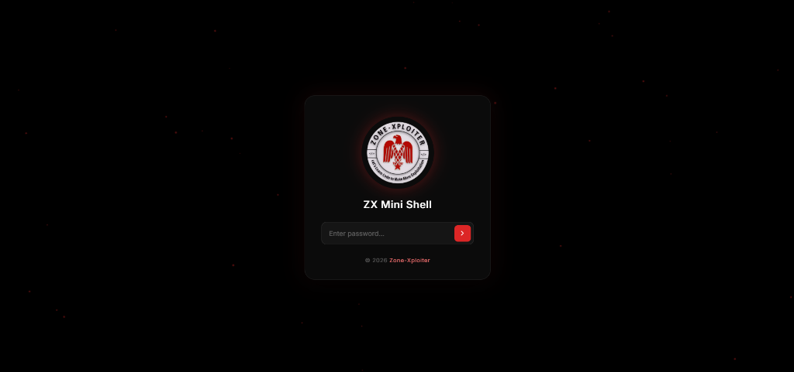

<p align="center">
  
</p>

# ZX Mini Shell

A lightweight, compact, and modern PHP Web File Manager.

---

## Features

- **Secure Bcrypt Authentication**: Robust password protection using `password_verify()`.
- **Compact All-In-One Status Bar**: Breadcrumb directory navigation merged with live server system info (OS, PHP version, IPs, disabled functions, MySQL & cURL status).
- **Interactive File Manager**:
  - Directory navigation, create folder, file upload.
  - In-browser file viewer and code editor with monospace typography.
  - Instant rename using SweetAlert2 modal popups.
  - Safe delete confirmation dialogs powered by SweetAlert2.

---

## Requirements

- PHP 7.4, 8.0, 8.1, 8.2, 8.3, or 8.4+
- Web Server: Apache, Nginx, or PHP Built-in Server

---

## Installation & Configuration

1. Place `zx.php` inside your web server root or desired subfolder.
2. Configure your password hash in `zx.php`:
   ```php
   $auth_pass = '$2a$12$QKXm8Ps1Yu9Vy5paliQtweQwH2dfgS6Qid2YDV.z6j3017FyiIetm';
   ```
   To generate a new Bcrypt hash, you can use [Bcrypt Generator](https://bcrypt-generator.com/) or via PHP:
   ```php
   echo password_hash('YourNewPassword', PASSWORD_BCRYPT);
   ```

---

## License

This project is licensed under the [MIT License](LICENSE).
